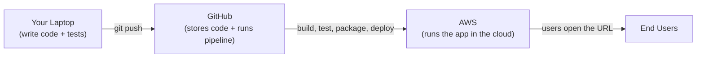
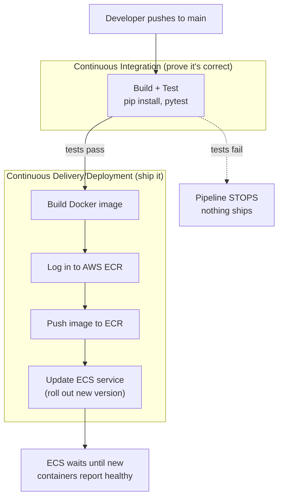
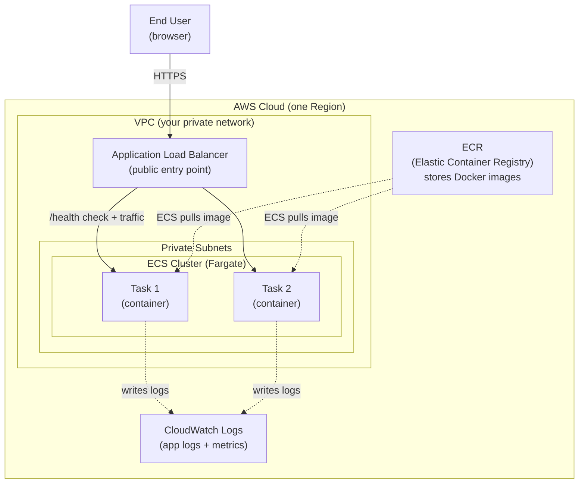
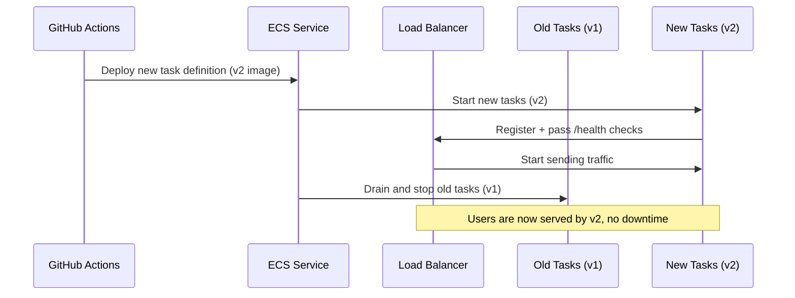

# Architecture: DevOps Lab with AWS Deployment

This document is your learning map. It explains how the whole system fits
together, from code on your laptop to a running container on AWS. Read it
top to bottom; each diagram zooms into a different layer.

---

## 1. The 10,000-foot view

Three worlds, connected by a pipeline:



- **Laptop:** where you write and test locally.
- **GitHub:** stores your code and runs the CI/CD pipeline (GitHub Actions).
- **AWS:** where the packaged container actually runs and serves traffic.

---

## 2. The CI/CD pipeline flow

This is what happens automatically on every push to `main`. Each stage is
a gate: if it fails, the stages after it never run.



Key idea: **the artifact that gets tested, packaged, and deployed is the
same Docker image.** Build once, run the same thing everywhere.

---

## 3. The AWS runtime architecture (ECR + ECS Fargate)

This is where the container actually runs in the cloud. We use **Fargate**,
which runs containers without you managing any servers (no EC2 to patch).



### What each piece does

| Component | Role | Why it matters |
|-----------|------|----------------|
| **ECR** | Private Docker image registry | ECS pulls your image from here to run it. |
| **ECS Cluster** | Logical group that runs your tasks | The "where my containers live" boundary. |
| **Fargate** | Serverless compute for containers | You don't manage servers; AWS runs the containers. |
| **Task** | One running copy of your container | Scale out = more tasks. Here we run 2 for redundancy. |
| **Task Definition** | The blueprint for a task | Says which image, CPU/memory, ports, env vars, logs. |
| **Service** | Keeps N tasks running + does rollouts | Restarts crashed tasks, handles deploys. |
| **ALB** | Load balancer / public front door | Spreads traffic across tasks, runs `/health` checks. |
| **VPC + Subnets** | Your isolated network | Tasks live in private subnets; only the ALB is public. |
| **CloudWatch** | Logs and metrics | Where you look when something breaks. |

---

## 4. How a deployment rolls out (zero-downtime)

When the pipeline updates the ECS service with a new image, ECS does a
**rolling update** so users never see downtime:



If the new version fails its health checks, ECS can keep the old version
running so a bad deploy doesn't take the app down.

---

## 5. Mapping lab concepts to AWS services

Everything you built locally has a cloud counterpart:

| Lab (local) | AWS (cloud) |
|-------------|-------------|
| `docker build` on your laptop | GitHub Actions builds + pushes to **ECR** |
| `docker compose up` | **ECS Service** running Fargate **Tasks** |
| `localhost:5000` | **ALB** public DNS name (or your domain) |
| `/health` endpoint | **ALB health check** target |
| Terminal output / logs | **CloudWatch Logs** |
| `.venv` + `requirements.txt` | Baked into the **Docker image** |

---

## 6. Security & cost notes (important in the cloud field)

- **Least privilege IAM:** the pipeline's AWS credentials should only be
  allowed to push to ECR and update this one ECS service, nothing more.
- **Secrets:** AWS keys live in **GitHub Secrets**, never in the repo.
  Even better for production: use **OIDC** so GitHub assumes an IAM role
  with no long-lived keys at all.
- **Private subnets:** tasks aren't directly reachable from the internet;
  only the ALB is. This shrinks the attack surface.
- **Cost:** ECS Fargate + ALB are not free-tier-friendly for 24/7 use.
  Expect a small monthly cost (mostly the ALB ~\$16/mo + Fargate usage).
  **Always tear it down after the lab** (see AWS_SETUP.md) to avoid charges.

---

## 7. Where to go deeper

- Swap long-lived AWS keys for **GitHub OIDC** (no stored secrets).
- Add **auto-scaling** so ECS adds tasks under load.
- Add a **custom domain + HTTPS** via Route 53 + ACM certificate.
- Define all of this as code with **Terraform** or **AWS CloudFormation**
  instead of clicking in the console (this is the real DevOps endgame).
```
