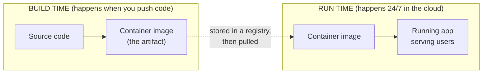
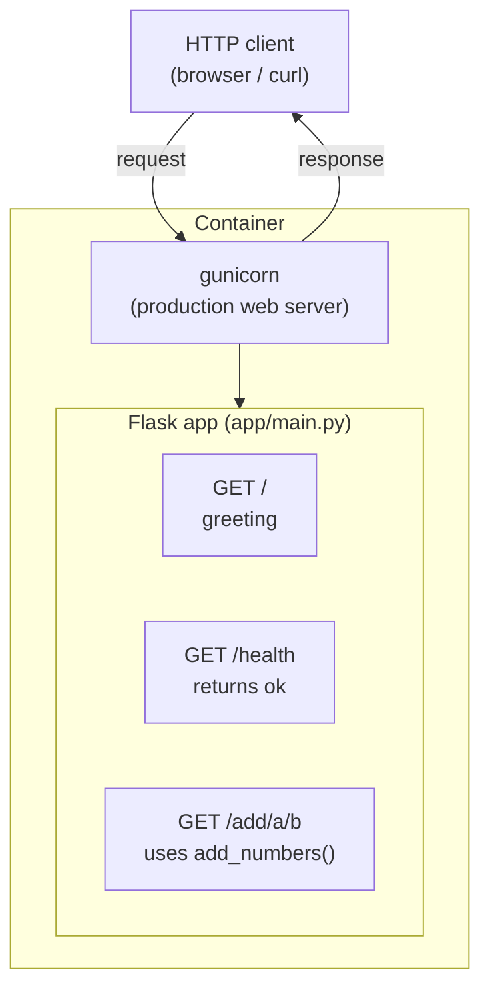
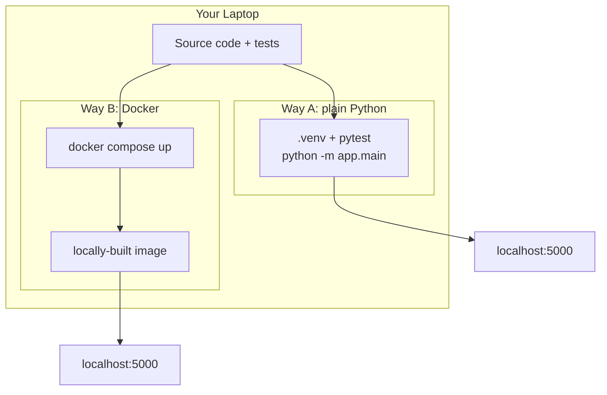
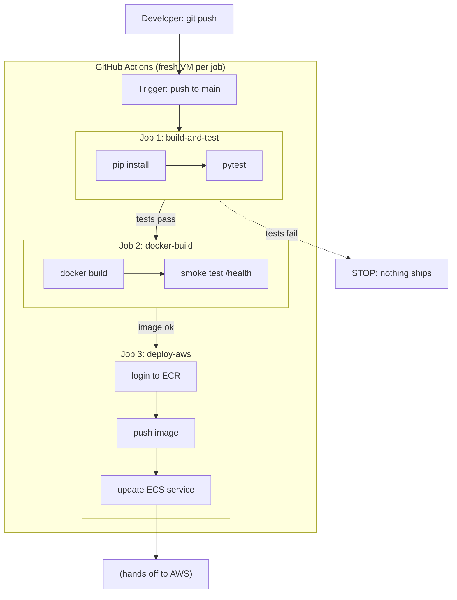
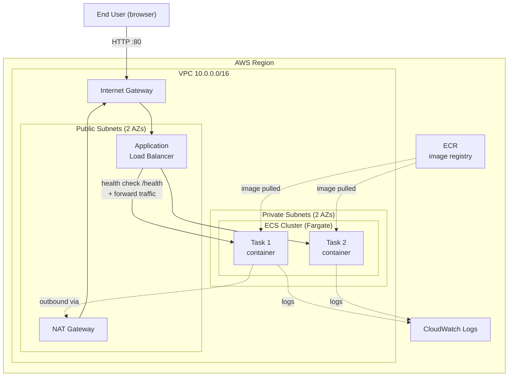
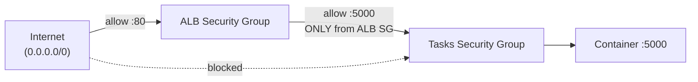
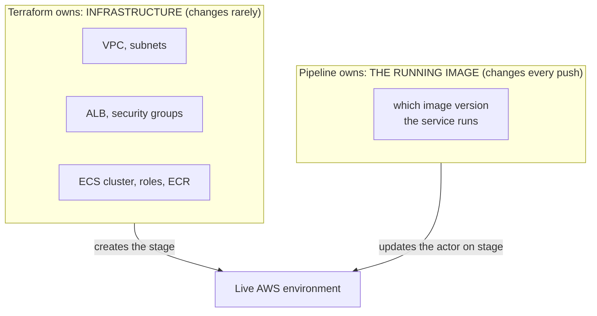
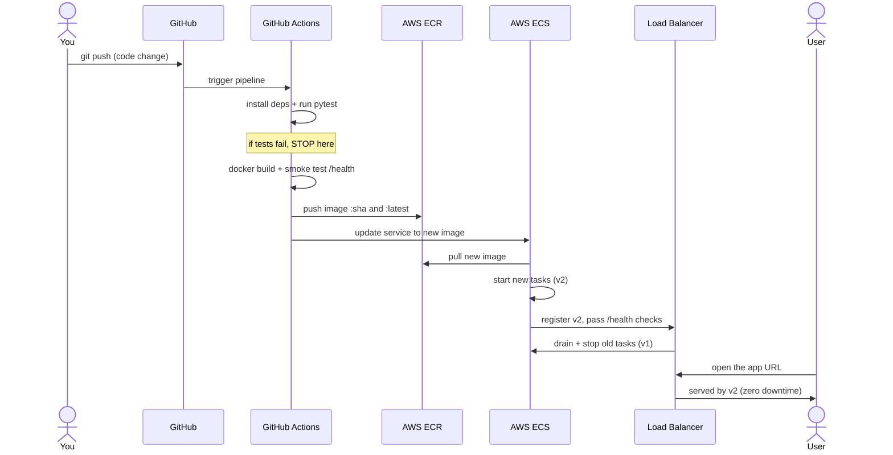

# The Complete Architecture Guide (Beginner → Confident)

This is the one document to understand the whole lab. It is layered: each
section zooms into a different level, from your source code up to the live
cloud system. Read top to bottom the first time; later, jump to whatever
layer you're working on.

> How to read the diagrams: boxes are *things* (files, servers, services),
> arrows are *flows* (data, traffic, or "triggers"). Dotted arrows mean
> "happens in the background" or "pulls from".

---

## Layer 0 — The mental model (the only thing you must memorize)

A DevOps system has two halves that meet at a container image:

- **Build time:** turn code into a single, versioned **image**. Done once per change by the pipeline.
- **Run time:** the cloud pulls that image and runs copies of it to serve users.
- The **image** is the handoff point. Everything else is plumbing around it.

Hold onto this. Every diagram below is just a zoom-in on one of these halves.

---

## Layer 1 — The application architecture

What's inside the thing we ship. It's deliberately tiny.

Key ideas:
- **gunicorn** is the real server; Flask's built-in server is dev-only.
- **`create_app()`** is a factory function so tests can build the app
  without starting a server.
- **`/health`** exists purely so infrastructure can ask "are you alive?"
  This single endpoint is load-bearing for the whole deployment.

---

## Layer 2 — The local development architecture

How it runs on your laptop, two ways.

Why two ways?
- **Plain Python** is the fast inner loop: edit, run tests, repeat.
- **Docker** proves the app runs the *same way it will in the cloud*.
  If it works in the container locally, it'll work on AWS.

---

## Layer 3 — The CI/CD pipeline architecture

What GitHub Actions does automatically on every push to `main`. This is
the "build time" half from Layer 0, expanded.

The golden rule, drawn: **each job `needs` the previous one.** A failure
anywhere stops the line, so broken code can never reach `deploy`.

Two tags matter on the pushed image:
- `:<git-sha>` — the exact, traceable version (which commit is this?).
- `:latest` — a moving pointer to the newest image.

---

## Layer 4 — The AWS runtime architecture

The "run time" half from Layer 0, expanded. This is where the container
actually lives and serves users.

Why it's shaped like this (the important part):
- **ALB in public subnets** = the only thing reachable from the internet.
- **Tasks in private subnets** = never directly reachable; much safer.
- **NAT gateway** = lets private tasks make *outbound* calls (pull image,
  reach AWS APIs) without being reachable *inbound*.
- **2 Availability Zones** = if one AWS data center has a problem, the
  other keeps serving. This is how you get resilience.

---

## Layer 5 — Security groups (the firewalls), zoomed in

This small diagram explains the single most important security concept
in the whole setup.

- The ALB firewall accepts port 80 from **anyone**.
- The task firewall accepts port 5000 from **only the ALB's firewall**.
- So there is no path from the open internet straight to a container.
  Traffic must go through the load balancer. This is "defense in depth".

---

## Layer 6 — Who owns what: Terraform vs the Pipeline

A frequent beginner confusion: "both Terraform and the pipeline touch
AWS, don't they collide?" No, because they own different things.

- **Terraform**: run `terraform apply` when you change infra (rare).
- **Pipeline**: runs on every code push to swap in a new image (often).
- The handshake: `ecs.tf` sets `ignore_changes = [task_definition]` so
  Terraform won't undo what the pipeline deployed. Terraform builds the
  theater; the pipeline keeps changing which actor is on stage.

---

## Layer 7 — The full lifecycle of one code change (end to end)

Everything above, combined into one story. Follow a single edit from your
keyboard to a user seeing it.

If you understand this one sequence, you understand the lab.

---

## Layer 8 — The file-to-concept map

Where each concept lives in the repo, so you can connect docs to code.

| Concept | File(s) | Layer |
|---------|---------|-------|
| The app | `app/main.py` | 1 |
| Quality gate (tests) | `tests/test_app.py` | 3 |
| Packaging recipe | `Dockerfile`, `.dockerignore` | 0, 2 |
| Local run | `docker-compose.yml` | 2 |
| The pipeline | `.github/workflows/pipeline.yml` | 3 |
| ECS blueprint (manual) | `aws/task-definition.json` | 4 |
| Network | `terraform/network.tf` | 4, 5 |
| Registry + logs | `terraform/ecr.tf` | 4 |
| Permissions | `terraform/iam.tf` | 4 |
| Load balancer + firewalls | `terraform/alb.tf` | 5 |
| Cluster/service | `terraform/ecs.tf` | 4, 6 |
| AWS setup walkthrough | `AWS_SETUP.md` | 4 |

---

## Glossary (plain-English)

- **Image:** a frozen, runnable snapshot of your app + its dependencies.
- **Container:** a running instance of an image.
- **Registry (ECR):** a storage locker for images.
- **Task (ECS):** one running container (plus its settings) on Fargate.
- **Task definition:** the blueprint describing how to run a task.
- **Service (ECS):** keeps N tasks alive and does rolling deploys.
- **Cluster (ECS):** the logical group the service and tasks live in.
- **Fargate:** run containers without managing any servers.
- **ALB:** load balancer; the public front door that spreads traffic.
- **Target group:** the set of tasks the ALB sends traffic to.
- **Health check:** the ALB polling `/health` to decide who gets traffic.
- **VPC:** your private, isolated network inside AWS.
- **Subnet:** a slice of the VPC; public = internet-facing, private = not.
- **Security group:** a virtual firewall around a resource.
- **IGW / NAT:** internet in (via ALB) / outbound-only internet for tasks.
- **CI / CD:** automatically integrate+test / automatically deploy.
- **IaC (Terraform):** infrastructure defined as version-controlled code.

---

## A learning path (do these in order)

1. Run `pytest` locally. Read `app/main.py` alongside Layer 1.
2. Run `docker compose up --build`. Re-read Layer 2.
3. Push to GitHub, watch the Actions tab. Follow along with Layer 3.
4. (Optional cloud) `terraform apply`, then push again. Watch Layer 7
   happen for real, and open the `app_url` output.
5. Break a test on purpose and watch the pipeline stop at Layer 3.
6. Tear down with `terraform destroy` so nothing costs money.
